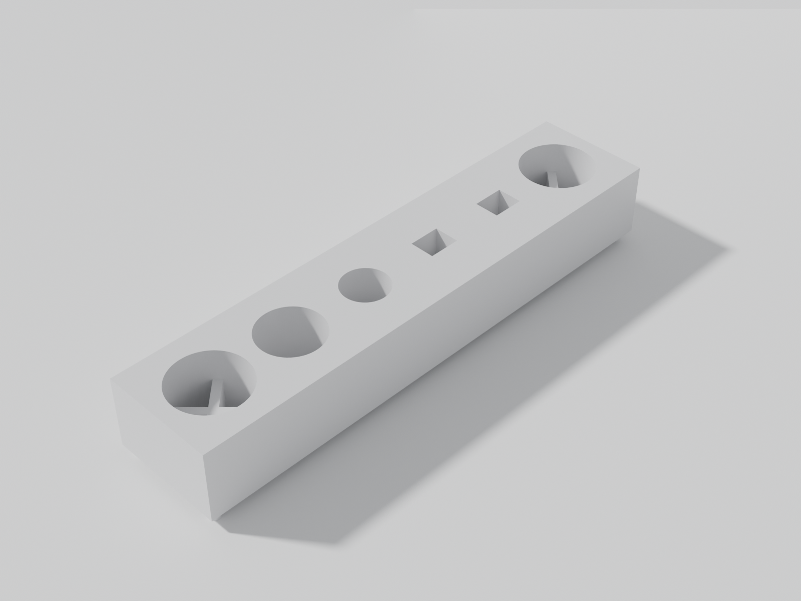
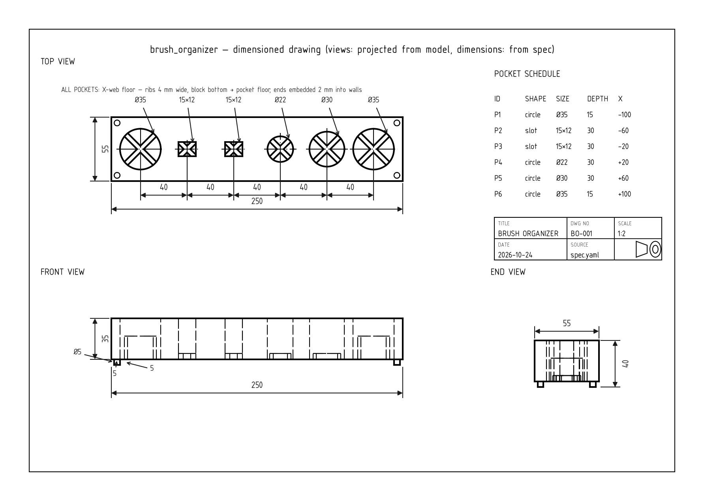

# CAD Workshop

Headless parametric CAD workspace: models are built from written specs, verified by automated tests, and reviewed through generated previews. Built on [build123d](https://github.com/gumyr/build123d) (Python + OpenCascade), designed for AI-assisted modeling where the machine — not memory — proves correctness.




*Left: presentation render (headless Blender Cycles from the verified STL). Right: dimensioned drawing generated directly from `spec.yaml`. More views: [`visuals/`](specs/brush_organizer/visuals/).*

## Why code-first, headless

- **Code is the single source of truth.** Every model is a readable, versioned Python script. Geometry changes are diffs, not redraws.
- **Verification over confidence.** Dimensions, volumes, topology and export integrity are checked by automated tests. A model is "done" when the tests pass, not when it looks plausible.
- **No GUI required.** Modeling, testing, export and preview rendering all run headless. Interactive viewers are optional, never a dependency.

## The core loop

```text
spec (approved dimensions) → model (build123d) → tests (pytest) → previews (PNG) → human review
```

1. A drawing or sketch is transcribed into a machine-readable `spec.yaml` and **approved by a human** before any modeling starts.
2. The model script reads parameters from the spec — never from memory or hard-coded magic numbers.
3. Tests assert every dimension in the spec against the measured geometry, and a completeness check ensures no dimension is silently untested.
4. Headless previews are rendered for visual review; a verification report compares drawing dimensions to measured values.
5. Changes are reviewed as diffs and merged only after CI and human approval.

Details: [docs/01-workflow.md](docs/01-workflow.md), [docs/04-verification-workflow.md](docs/04-verification-workflow.md).

## Repository map

```text
cad-workshop/
├── README.md            # this file
├── docs/                # workflow, environment, testing, verification, modeling rules, lessons, new-part checklist
│   └── legacy/          # original study notes (preserved, superseded)
├── specs/               # one folder per part: spec.yaml, verification report, previews, visuals
├── models/              # build123d model scripts (read spec.yaml)
├── tests/               # pytest suite: dimension, topology, validity, export checks
├── examples/            # small scripts demonstrating specific build123d features
├── tools/               # preview rendering, drawing generation, visualization helpers
└── exports/             # generated output (STEP/STL/PNG), not versioned
```

## Quick start

```bash
python -m venv .venv && source .venv/bin/activate
pip install --upgrade pip
pip install -r requirements.txt
pytest                # run the verification suite
```

Environment details: [docs/02-environment.md](docs/02-environment.md).

## Continuous integration

Every push to `main` runs the full test suite on GitHub Actions; documentation-only changes skip the suite (`paths-ignore` for `*.md` and `docs/`). CI is the single source of truth for code correctness; visual correctness is judged by a human against the original intent. See [docs/03-testing.md](docs/03-testing.md).

## Status

The verification loop is proven end-to-end on two parts:

- **test_block** — reference part (60×30×8, 2× Ø6, 40 mm pitch), the calibration
  target for the whole workflow.
- **brush_organizer** — first real part (M3): 6 pockets with X-rib floors on
  corner legs, transcribed from a hand sketch, corrected in three rounds,
  20/20 tests passing, exported (STL/STEP) and **accepted by the owner on
  2026-10-20**. Presentation renders (`specs/brush_organizer/visuals/`) were
  produced with a headless Blender Cycles pipeline from the verified STL
  ([tools/render_blender.py](tools/render_blender.py)), and a dimensioned
  drawing is generated directly from `spec.yaml`
  ([tools/render_drawing.py](tools/render_drawing.py)).
  External FDM printing is planned but not yet done.

Current open tasks: first external print of the brush organizer, and
presentation polish (render style, optional hero variant with brushes) — see
[docs/06-lessons-learned.md](docs/06-lessons-learned.md). To add your own
part, follow [docs/07-new-part-checklist.md](docs/07-new-part-checklist.md).

## License

MIT — see [LICENSE](LICENSE).
